<picture>
  <source media="(prefers-color-scheme: dark)" srcset="./assets/banner-dark.svg" />
  <source media="(prefers-color-scheme: light)" srcset="./assets/banner-light.svg" />
  
</picture>

 

 

### Currently

- 🤖 **Robot learning research** at USC: evaluating memory-augmented vision-language-action (VLA) models on simulated manipulation benchmarks (paper under review)
- 🎮 **The Shared Gaming Lab**: playable 3D story worlds in the browser, *Honorable Mention at USC SEP Hacks (LA Tech Week)*
- 📚 **Squo** (co-founder): an AI tutor that adapts by watching how students actually work through problems
- 🛠️ **Previously built:** an Arduino-powered electric clarinet, about 85% cheaper than an entry-level instrument
- 🌱 **Learning:** PyTorch and robot-learning tooling

### Languages & tools

<picture></picture>
<picture></picture>
